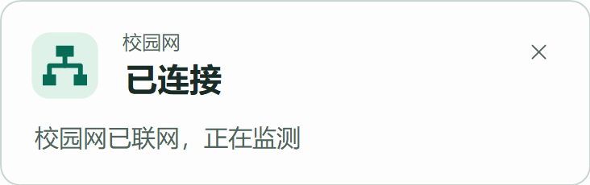
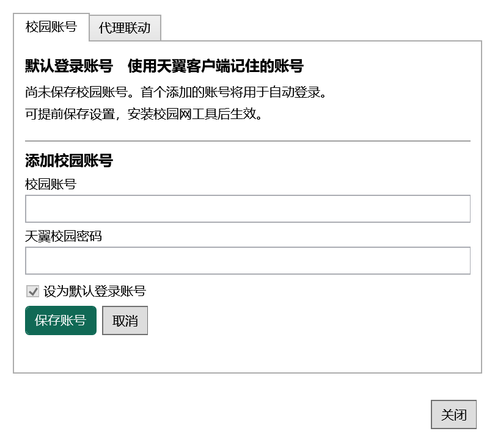
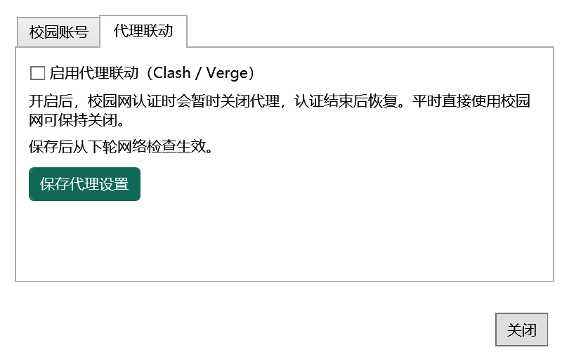

# 五邑大学校园网自动登录

在 Windows 上通过天翼校园客户端登录五邑大学校园网。登录 Windows、从睡眠唤醒或校园网断线后，工具会检查网络并在需要时重新认证。**默认只连接校园网，代理联动默认关闭。**

## 下载与安装

| 使用场景 | 文件 |
|---|---|
| 首次安装，或修复已删除的计划任务 | [完整安装包 ZIP](https://github.com/st-cx/WYU-ESurfing-Auto-Login/releases/download/v1.7.0/WYU-ESurfing-Auto-Login-v1.7.0.zip) |
| 已有安装，需要单文件离线升级 | [更新 EXE](https://github.com/st-cx/WYU-ESurfing-Auto-Login/releases/download/v1.7.0/CampusNet-Update-1.7.0.exe) |
| 使用命令行升级或预检 | [更新 CMD](https://github.com/st-cx/WYU-ESurfing-Auto-Login/releases/download/v1.7.0/CampusNet-Update-1.7.0.cmd) |

1. 使用 Windows 10 或 11，在校园网环境接好网线，安装学校使用的广东电信**天翼校园客户端**。
2. 完整解压 ZIP，双击 **一键安装.bat**，按 Windows 提示授予安装权限。如果有多个在用的物理网卡，选择接入校园网的那个。
3. 如果天翼已记住账号和密码，安装完成后即可使用。如果还没有保存账号，右键任务栏右下角的校园网图标，选择 **添加账号**。图标也可能在任务栏的隐藏图标区。

点击托盘图标可以查看连接状态。长提示会换行，也可滚动查看。安装时无需断开网络做校准。



## 添加账号与切换默认账号

打开托盘里的 **账号与设置**，也可以双击安装包中的 **校园网设置.cmd**。

- **添加账号**　输入自己的天翼校园账号和密码并保存。支持保存多个账号。第一次添加且此前没有指定默认账号时，该账号会成为默认账号。
- **切换默认账号**　在已保存列表中选择账号并设为默认，下次需要认证时使用。当前已联网时可以继续上网。
- **更新密码**　保存同一账号的新密码即可，下次认证使用新密码。
- **使用天翼记住的账号**　可随时切回此方式。删除已保存的当前默认账号也会切回此方式。

自动填写和识别支持 **6 至 16 位数字**的天翼账号。其他格式请直接在天翼客户端手动登录。保存的密码由 Windows 当前用户的 DPAPI 在本机加密，认证时只读取所选账号的密码。



## 可选的代理联动

需要配合 Clash / Clash Verge 的用户，在 **账号与设置 → 代理联动** 勾选 **启用代理联动**，再点 **保存代理设置**。只登录校园网的用户可以一直保持关闭。

| 设置 | 实际行为 |
|---|---|
| **关闭（默认）** | 检查校园网直连、识别天翼登录界面并按需认证。无需安装代理，已安装的 Verge 也不会因此被启动或停止。 |
| **开启** | 认证时根据原有代理状态临时处理系统代理、PAC 或 TUN，结束后恢复并验证连接。仅代理故障时可独立处理。 |

开关在后续监测和认证时生效。上一版若留下了一笔未完成的代理恢复记录，工具会先还原这笔操作。从旧版升级后，如需继续使用原来的 `proxy_guard` 功能，请在这里开启代理联动。便携 Clash 的运行配置路径仍可在 `config.json` 中指定 `clash_config_path`。



## 升级与排障

- 从旧版升级时保留网卡、校准和已有的本机账号。启动时直接使用默认账号，省去十秒账号倒计时。新版安装和更新不向其他校园网脚本添加代码。
- 更新 CMD 优先校验同目录 EXE 或本机缓存。仅下载 CMD 且本机还没有更新器时，它会从本版本的 GitHub Release 取得 EXE 并核对 SHA-256。可运行 `.\CampusNet-Update-1.7.0.cmd --check` 做预检。[发布说明及校验文件](https://github.com/st-cx/WYU-ESurfing-Auto-Login/releases/tag/v1.7.0)
- 天翼改版后若无法识别登录按钮，可从完整包运行 **校准按钮坐标.bat**。它会引导一次实际断开和手动登录。
- 配置和日志在 `%LOCALAPPDATA%\CampusNetWatchdog\`。本机账号和代理开关由设置窗口管理。网络参数示例见 [config.example.json](config.example.json)。
- 高级诊断保留 `watchdog.ps1 -Check`、`-RecoverOnce`、`-RestoreNetwork` 及原有 `command.txt` 命令。`-Check` 只读检查，`-RecoverOnce` 执行一次恢复，`-RestoreNetwork` 可还原已有的代理保护记录。需要截图时可主动使用 `shot`。
- 移除程序可在完整包中运行 **卸载.bat**。程序会清理本工具的任务、安装目录以及保存在该目录中的账号。天翼客户端本身和其他工具的独立账号库继续由各自管理。

在解压后的根目录可以运行完整回归测试。

```powershell
powershell -NoProfile -ExecutionPolicy Bypass -File tests\run-all.ps1
pwsh -NoProfile -File tests\run-all.ps1
```

计划任务在使用者登录 Windows 后运行。锁屏时能否完成认证取决于天翼是否能提供可识别的登录画面。其他运营商客户端、其他学校及 macOS/Linux 不在本工具的验证范围内。

[更新记录](CHANGELOG.md) · [MIT 许可证](LICENSE)
